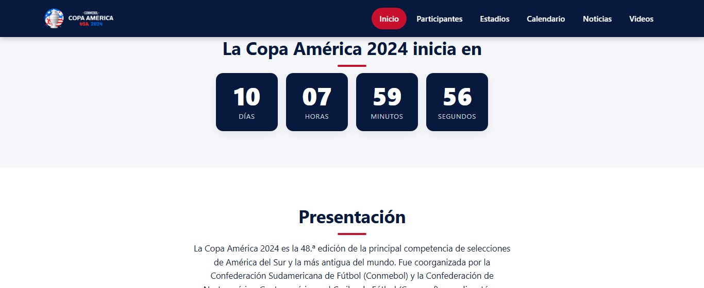
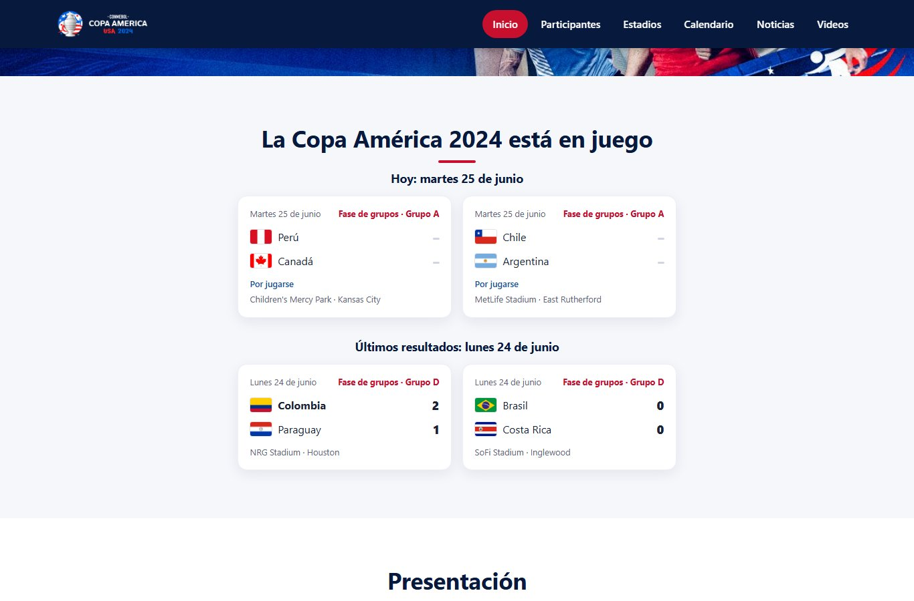
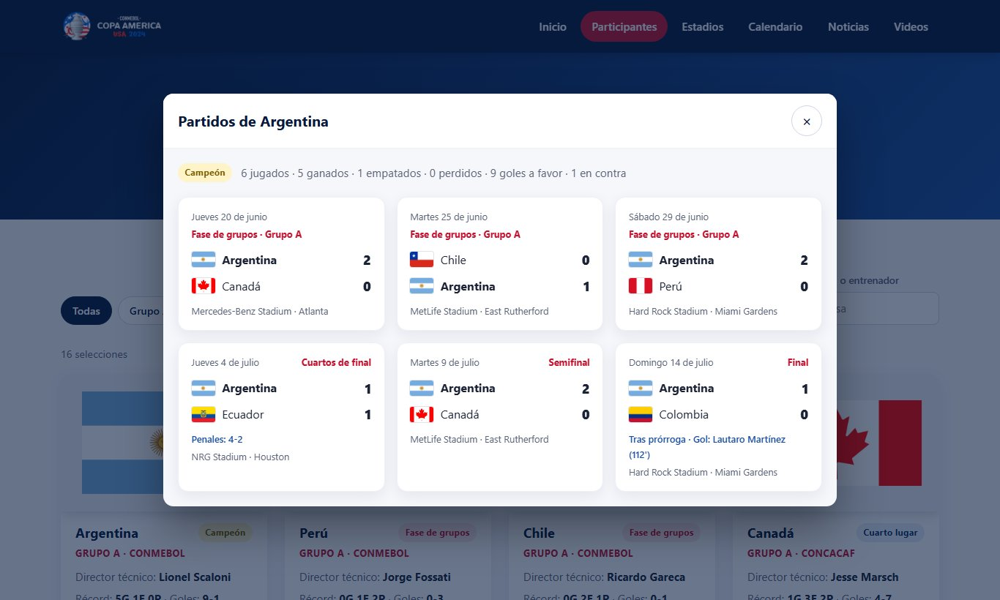
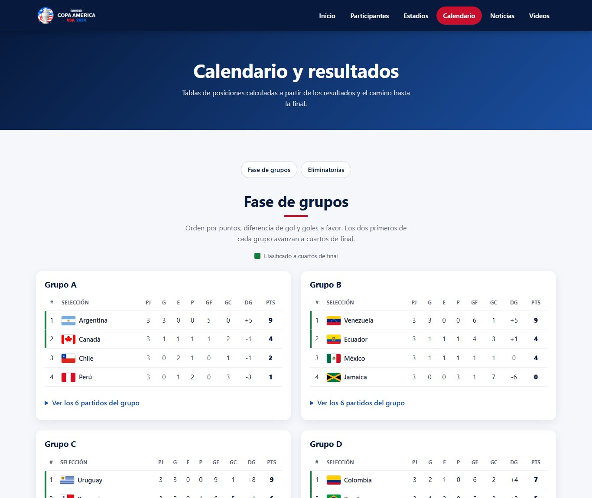
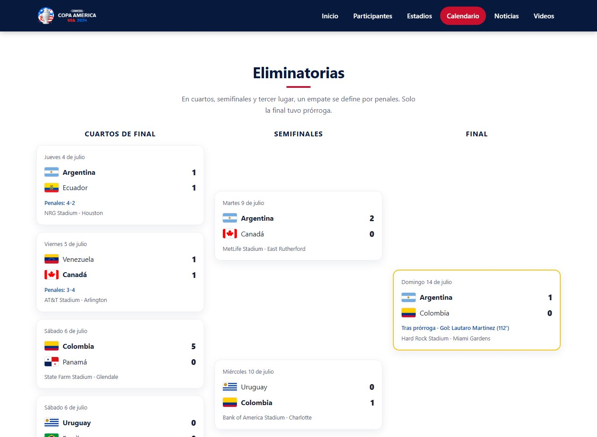
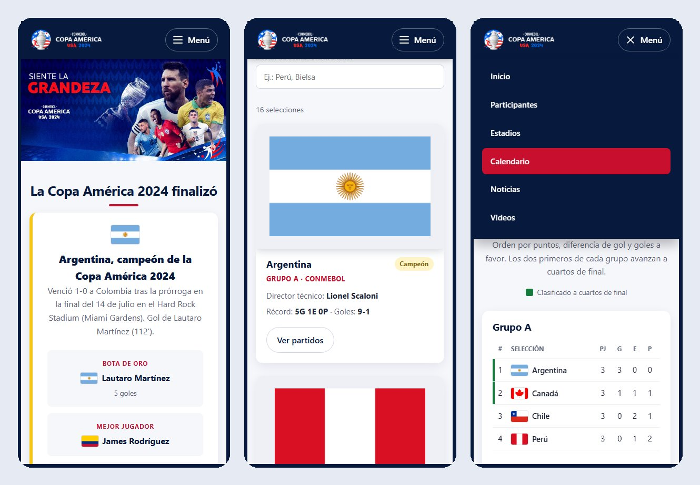

# Copa América 2024 — Sitio Web Informativo

Sitio web sobre la **Copa América 2024**, la 48.ª edición del torneo de selecciones más antiguo del mundo, disputado en Estados Unidos del 20 de junio al 14 de julio de 2024.

Reúne la presentación del torneo, el campeón y los premios, las 16 selecciones, los 14 estadios, el calendario completo con tablas de posiciones calculadas automáticamente, noticias y videos oficiales. Está hecho con **HTML5, CSS3 y JavaScript**, sin frameworks ni dependencias. Funciona en computadoras, tabletas y celulares.

---

## Tabla de contenidos

- [Vista general](#vista-general)
- [Capturas del sistema](#capturas-del-sistema)
- [Funcionalidades](#funcionalidades)
- [Tecnologías utilizadas](#tecnologías-utilizadas)
- [Estructura del proyecto](#estructura-del-proyecto)
- [Ejecución rápida en Windows](#ejecución-rápida-en-windows)
- [Instalación y ejecución](#instalación-y-ejecución)
- [Simular una fecha del torneo](#simular-una-fecha-del-torneo)
- [Arquitectura](#arquitectura)
- [Cómo actualizar los datos](#cómo-actualizar-los-datos)
- [Pruebas y validación](#pruebas-y-validación)
- [Accesibilidad y rendimiento](#accesibilidad-y-rendimiento)
- [Historial de mejoras](#historial-de-mejoras)
- [Cómo contribuir](#cómo-contribuir)
- [Licencia](#licencia)
- [Autor](#autor)

---

## Vista general

| Página | Archivo | Contenido |
|---|---|---|
| Inicio | `index.html` | Portada, estado del torneo (cuenta regresiva, partidos en juego o campeón), presentación, cifras, noticias y videos |
| Participantes | `participantes.html` | Las 16 selecciones con grupo, director técnico, récord, resultado final y detalle de sus partidos |
| Estadios | `estadios.html` | Los 14 estadios con ciudad, capacidad, partidos jugados y ubicación en el mapa |
| Calendario | `calendario.html` | Tablas de posiciones de los 4 grupos, todos los partidos y el cuadro de eliminación directa |

---

## Capturas del sistema

### Inicio

Encabezado fijo con menú, portada y el estado del torneo. Como el torneo ya terminó, se muestra el campeón, el resultado de la final y los premios individuales.


### Estados del torneo

La sección principal cambia sola según la fecha. Antes del torneo muestra una cuenta regresiva hacia el partido inaugural; durante el torneo, la próxima jornada y los últimos resultados.





### Noticias

Carrusel con fuente, titular y enlace a la nota original. Tiene botones de anterior y siguiente, indicadores, pausa, y se puede usar con el teclado o deslizando el dedo.


### Videos

Los videos se muestran con una portada liviana y el reproductor de YouTube se carga solo al pulsar reproducir.


### Participantes

Tarjetas de las 16 selecciones con filtros por grupo y confederación, y búsqueda por país o entrenador. Cada tarjeta indica hasta dónde llegó la selección.


### Detalle de una selección

Al pulsar "Ver partidos" se abre una ventana con el resumen y todos los partidos de esa selección.



### Estadios

Tarjetas de los 14 estadios con búsqueda por nombre, ciudad o estado, y orden por capacidad, cantidad de partidos o nombre.


### Calendario y tablas de posiciones

Las tablas se calculan a partir de los resultados. Los dos primeros de cada grupo aparecen marcados como clasificados.



### Eliminatorias

Cuadro de cuartos de final, semifinales y final, con penales y prórroga cuando corresponde.



### Versión móvil

El diseño se adapta a pantallas pequeñas y el menú pasa a ser un panel desplegable.



---

## Funcionalidades

**Generales**

- Encabezado fijo con menú y página actual resaltada; en celulares, menú desplegable.
- Diseño adaptable (responsive) con CSS Grid y Flexbox.
- Una sola fuente de datos para todo el sitio: cualquier cambio en los datos se refleja en todas las páginas.
- Simulación de fechas para ver el sitio como se veía antes o durante el torneo.

**Inicio**

- Estado del torneo que cambia según la fecha:
  - **Antes:** cuenta regresiva (días, horas, minutos y segundos) hacia el partido inaugural.
  - **Durante:** partidos del día o de la próxima jornada y resultados de la última jornada.
  - **Después:** campeón, resultado de la final y premios individuales.
- Cifras del torneo calculadas a partir de los datos (selecciones, estadios, partidos y goles).
- Carrusel de noticias accesible, con pausa automática al pasar el mouse o enfocar con el teclado.
- Videos que cargan el reproductor solo al pulsar. Si el sitio se abre como archivo local, el video se abre en YouTube.

**Participantes**

- Filtros por grupo (A a D) y por confederación (Conmebol o Concacaf).
- Búsqueda por país o director técnico, sin importar tildes ni mayúsculas.
- Insignia con el resultado de cada selección: campeón, subcampeón, tercer lugar, cuartos de final o fase de grupos.
- Récord (ganados, empatados, perdidos) y goles a favor y en contra.
- Ventana con todos los partidos de la selección.

**Estadios**

- Búsqueda por estadio, ciudad o estado, y cuatro criterios de orden.
- Cantidad de partidos por estadio y distintivos de "Partido inaugural" y "Sede de la final".
- Ventana con los partidos jugados en cada estadio y enlace a Google Maps.

**Calendario**

- Tabla de posiciones por grupo calculada con los resultados: puntos, diferencia de gol y goles a favor.
- Partidos de cada grupo en una sección desplegable.
- Cuadro de eliminación directa con indicación de penales y prórroga.
- Mientras una llave no está definida se muestra "Por definir".

---

## Tecnologías utilizadas

| Tecnología | Uso |
|---|---|
| HTML5 | Estructura semántica (`header`, `nav`, `main`, `section`, `article`, `dialog`) |
| CSS3 | Variables, Grid, Flexbox, diseño adaptable y animaciones que respetan la preferencia de movimiento reducido |
| JavaScript (ES2017+) | Lógica del torneo, generación de contenido, filtros, carrusel y ventanas de diálogo |
| Node.js (`node:test`) | Pruebas automatizadas de los datos y la lógica, sin dependencias |
| Python o Node.js | Servidor local para ver el sitio (`iniciar.bat` usa el que esté instalado) |

---

## Estructura del proyecto

```text
RepoCopaAmerica/
├── index.html                 Inicio
├── participantes.html         Selecciones participantes
├── estadios.html              Estadios sede
├── calendario.html            Calendario, tablas y eliminatorias
├── 404.html                   Página de error
├── css/
│   └── estilos.css            Hoja de estilos única del sitio
├── js/
│   ├── datos.js               Datos del torneo: selecciones, estadios, partidos y premios
│   ├── torneo.js              Lógica del torneo (funciones puras, probadas con Node)
│   ├── ui.js                  Componentes reutilizables: partido, bandera, diálogo
│   ├── comun.js               Menú en celulares
│   ├── contador.js            Estado del torneo en el inicio y cifras
│   ├── carrusel.js            Carrusel de noticias
│   ├── videos.js              Carga de videos bajo demanda
│   ├── participantes.js       Página de participantes
│   ├── estadios.js            Página de estadios
│   └── calendario.js          Página de calendario
├── images/                    Logo, portada, favicons y banderas
├── images_estadios/           Fotografías de los estadios
├── images_noticias/           Imágenes de las noticias
├── tests/
│   └── torneo.test.js         Pruebas automatizadas
├── docs/capturas/             Capturas usadas en este README
├── iniciar.bat                Inicia el sitio en Windows con doble clic
├── servidor.js                Servidor local en Node.js, sin dependencias
├── robots.txt, sitemap.xml    Archivos para buscadores
├── package.json               Comandos del proyecto (sin dependencias)
├── LICENSE                    Licencia MIT
└── README.md
```

---

## Ejecución rápida en Windows

1. Descarga o clona el proyecto.
2. Haz doble clic en **`iniciar.bat`**.
3. El sitio se abre solo en el navegador.

El archivo hace lo siguiente:

- Busca un puerto libre entre el 8000 y el 8010.
- Inicia un servidor local con **Python** o, si no está instalado, con **Node.js** (usando `servidor.js`). Ambos son gratuitos.
- Abre el navegador en `http://localhost:8000/` (o el puerto que haya encontrado libre).
- Si no encuentra ni Python ni Node.js, abre `index.html` directamente. Todo funciona igual, pero los videos se abren en YouTube.

Para detener el sitio, cierra la ventana negra o presiona `Ctrl + C`. Si solo quieres iniciar el servidor sin abrir el navegador:

```bat
iniciar.bat --sin-navegador
```

No necesita internet para funcionar, salvo para las portadas de los videos y los enlaces externos. Tampoco usa servicios en la nube ni funciones de pago.

---

## Instalación y ejecución

### 1. Clonar el repositorio

```bash
git clone https://github.com/AcuLuis/RepoCopaAmerica.git
cd RepoCopaAmerica
```

### 2. Levantar un servidor local

El sitio se puede abrir con doble clic en `index.html`, pero **YouTube no reproduce videos incrustados en páginas abiertas como archivo (`file://`)**. Para ver el sitio completo, sírvelo por HTTP con cualquiera de estas opciones:

```bash
# Con Python
python -m http.server 8000

# Con Node.js (servidor incluido en el proyecto, sin dependencias)
node servidor.js
```

También puedes usar la extensión *Live Server* de Visual Studio Code: clic derecho sobre `index.html` y **Open with Live Server**.

### 3. Abrir en el navegador

```
http://localhost:8000
```

---

## Simular una fecha del torneo

Agrega `?fecha=AAAA-MM-DD` a cualquier dirección del sitio para verlo como se veía ese día. Aparece una franja amarilla de aviso, y la fecha se mantiene al navegar entre páginas.

| Dirección | Qué muestra |
|---|---|
| `index.html?fecha=2024-06-10` | Cuenta regresiva hacia el partido inaugural |
| `index.html?fecha=2024-06-25` | Partidos del día y resultados de la jornada anterior |
| `calendario.html?fecha=2024-07-03` | Grupos terminados y cuartos de final por jugarse |
| `participantes.html?fecha=2024-07-11` | Selecciones eliminadas y las que siguen en competencia |

Como los datos no incluyen horarios, los partidos del día simulado se consideran pendientes.

---

## Arquitectura

El sitio sigue un flujo en una sola dirección: los datos se procesan con la lógica del torneo y luego se muestran en pantalla.

```text
js/datos.js   →   js/torneo.js   →   js/ui.js   →   js/<página>.js
  (datos)          (cálculos)        (componentes)     (cada página)
```

- **`datos.js`**: el único lugar donde están los datos. No contiene lógica.
- **`torneo.js`**: funciones puras que reciben una fecha y devuelven resultados (tablas, ganadores, estado del torneo). No tocan la página, por eso se pueden probar con Node.
- **`ui.js`**: componentes visuales que usan todas las páginas.
- **Scripts de página**: leen los datos a través de `torneo.js` y generan el contenido.

**Reglas de cálculo**

- Victoria 3 puntos, empate 1, derrota 0.
- Orden de la tabla: puntos, diferencia de gol, goles a favor y nombre.
- En eliminatorias, los penales definen al ganador, pero en las estadísticas el partido cuenta como empate.
- Las llaves de eliminación se resuelven según la posición en cada grupo (`1A`, `2B`) o el ganador o perdedor de un partido anterior (`G25`, `P30`).

---

## Cómo actualizar los datos

Toda la información está en [`js/datos.js`](js/datos.js).

**Corregir un resultado.** Cambia los goles del partido. Las tablas, insignias, cifras y el cuadro se recalculan solos:

```js
p(17, "grupos", "A", "2024-06-29", "ARG", 2, 0, "PER", "hard-rock"),
```

**Partido con penales o prórroga.**

```js
p(25, "cuartos", null, "2024-07-04", "ARG", 1, 1, "ECU", "nrg", { penales: [4, 2] }),
```

**Agregar una noticia.** Se edita en el carrusel de `index.html`: cada noticia es un `article.carrusel__diapositiva` con imagen, fuente, titular y enlace.

Después de cualquier cambio en los datos, ejecuta las pruebas para confirmar que todo sigue siendo coherente.

---

## Pruebas y validación

Las pruebas usan el ejecutor de pruebas que trae Node.js (versión 18 o superior), sin instalar nada:

```bash
npm test
```

Comprueban, entre otras cosas, que:

- hay 16 selecciones, 14 estadios y 32 partidos, y todas las referencias son válidas;
- cada selección juega tres partidos de grupo y cada estadio recibió al menos uno;
- las tablas de posiciones finales coinciden con las oficiales;
- las llaves de cuartos, semifinales, tercer lugar y final corresponden a las posiciones y ganadores calculados;
- el campeón, el subcampeón y el total de goles (70) son correctos;
- el estado del torneo y los partidos jugados dependen de la fecha.

De forma opcional, puedes validar el HTML en tu equipo con la configuración incluida en `.htmlvalidate.json`:

```bash
npx html-validate "*.html"
```

---

## Accesibilidad y rendimiento

- Enlace "Saltar al contenido principal" para usuarios de teclado.
- Foco visible en todos los elementos interactivos.
- Textos alternativos en imágenes y etiquetas descriptivas en botones.
- Carrusel con controles, pausa y anuncios para lectores de pantalla solo cuando el usuario lo controla.
- Ventanas de diálogo nativas (`<dialog>`) que se cierran con Escape o haciendo clic fuera.
- Animaciones desactivadas si el sistema pide movimiento reducido.
- Portada optimizada (de 1,5 MB a 180 KB) y fotos de estadios comprimidas (de 5,5 MB a 1,5 MB en total).
- Carga diferida de imágenes y del reproductor de YouTube.
- Metadatos para buscadores y redes sociales (descripción, Open Graph), `sitemap.xml` y `robots.txt`.

---

## Historial de mejoras

| Fase | Enfoque | Cambios principales |
|---|---|---|
| 1 | Correcciones | Carrusel que se cargaba dos veces, enlaces que no coincidían con la noticia, cuenta regresiva sin estado final, enlaces con datos de sesión, HTML inválido y nombres de archivo con caracteres especiales |
| 2 | Experiencia de usuario | Diseño responsive, menú uniforme con versión móvil, hoja de estilos única, tarjetas con CSS Grid, carrusel con controles y videos bajo demanda |
| 3 | Lógica funcional | Datos centralizados, selecciones y estadios faltantes, tablas de posiciones calculadas, página de calendario, filtros, búsquedas, estados del torneo y pruebas automatizadas |
| 4 | Calidad y ejecución local | Accesibilidad, optimización de imágenes, metadatos para buscadores, página 404 y ejecución con doble clic mediante `iniciar.bat` |

---

## Cómo contribuir

1. Haz un *fork* del repositorio.
2. Crea una rama para tu cambio: `git checkout -b mejora/nombre-del-cambio`.
3. Haz tus cambios y verifica que `npm test` pase.
4. Confirma los cambios: `git commit -m "Describe el cambio"`.
5. Sube la rama: `git push origin mejora/nombre-del-cambio`.
6. Abre un *Pull Request* explicando qué cambiaste y por qué.

---

## Licencia

El código fuente de este proyecto se distribuye bajo la **Licencia MIT**. Consulta el archivo [LICENSE](LICENSE) para más detalles.

**Contenido de terceros.** Los nombres, logotipos y marcas de la Copa América, la Conmebol, la Concacaf, las federaciones nacionales y los estadios, así como las imágenes de noticias y los videos incrustados, pertenecen a sus respectivos titulares. Se usan solo con fines educativos e informativos y no están cubiertos por la licencia MIT.

**Créditos de imágenes**

- Banderas: [Flagpedia / flagcdn](https://flagpedia.net), de dominio público.
- Children's Mercy Park: foto de [Lectrician2](https://commons.wikimedia.org/wiki/File:Children%27s_Mercy_Park_Aerial.jpg), licencia [CC BY-SA 4.0](https://creativecommons.org/licenses/by-sa/4.0/).
- Levi's Stadium: foto de [U.S. Customs and Border Protection](https://commons.wikimedia.org/wiki/File:Levi%27s_Stadium_in_February_2016_prior_to_Super_Bowl_50_(24398261729).jpg), de dominio público.

---

## Autor

**Luis Antonio Acuña Ayala**
GitHub: [@AcuLuis](https://github.com/AcuLuis)

Proyecto académico — ESAN.

---

<div align="center">

## ⭐ ¿Te gustó este proyecto? ⭐

Si este proyecto te resultó útil, te inspiró o simplemente te gustó,
**regálale una estrella en GitHub**. Es gratis, se hace en un segundo
y ayuda muchísimo a que más personas lo descubran. 🙌

[](https://github.com/AcuLuis/RepoCopaAmerica/stargazers)

**¡Gracias por tu apoyo!** 🏆⚽

</div>
