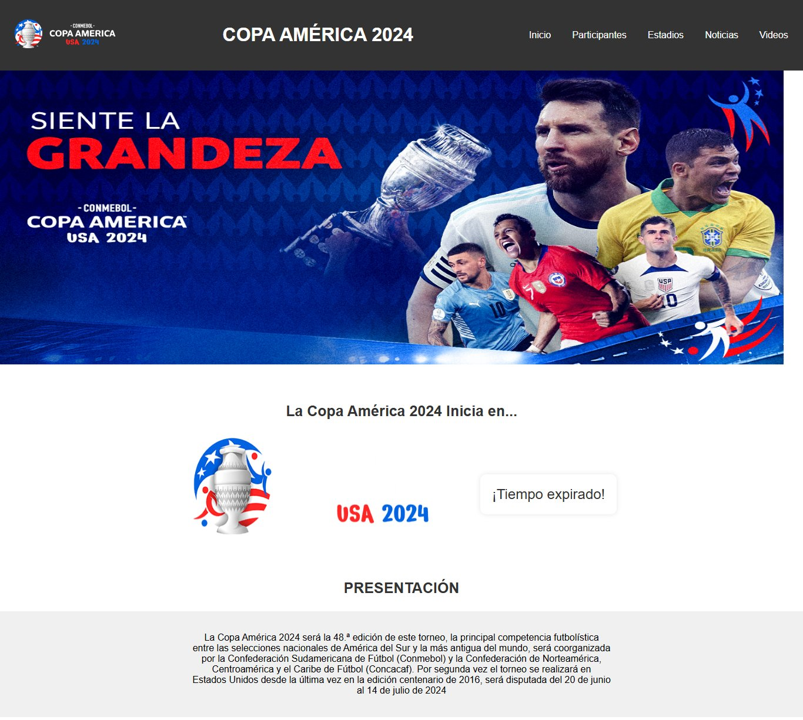
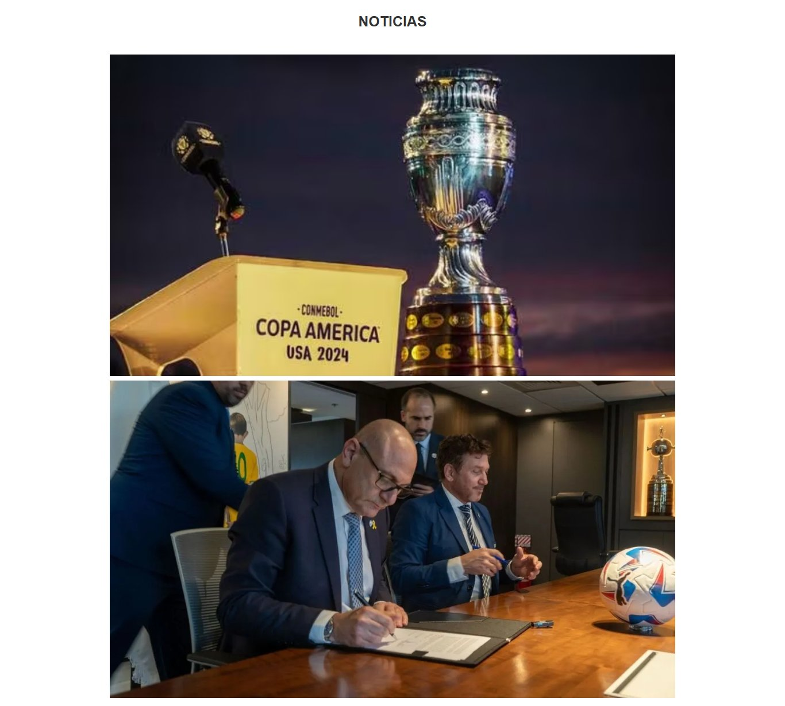
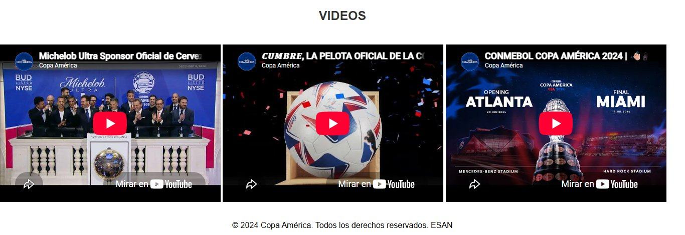
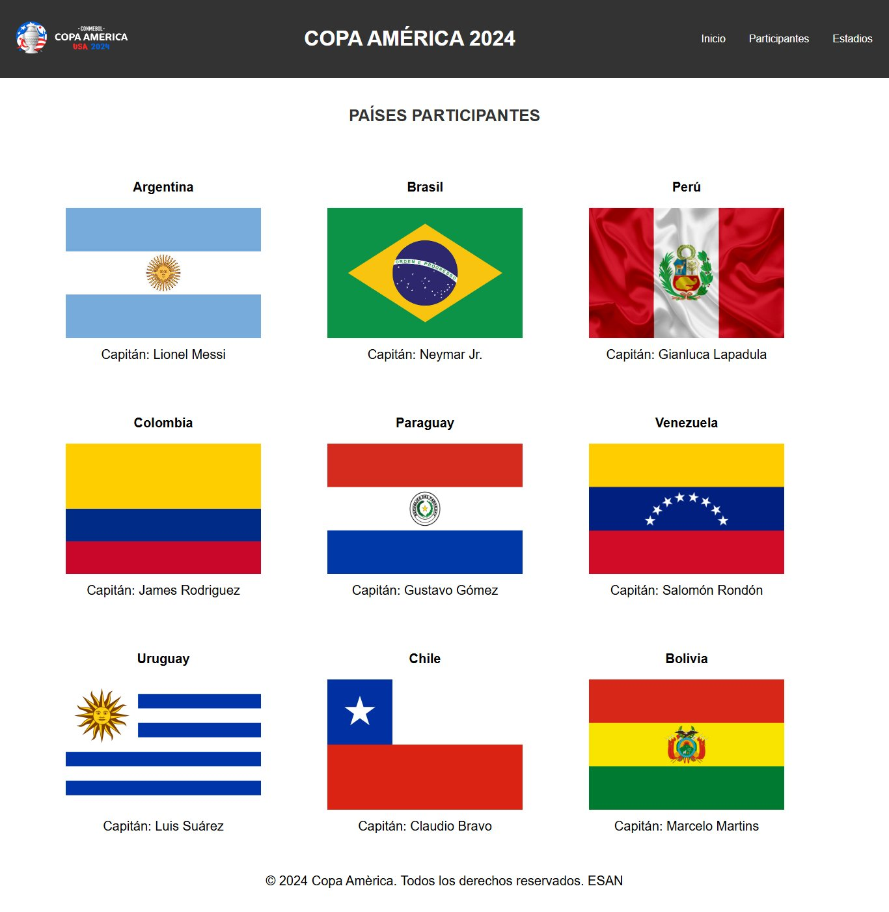
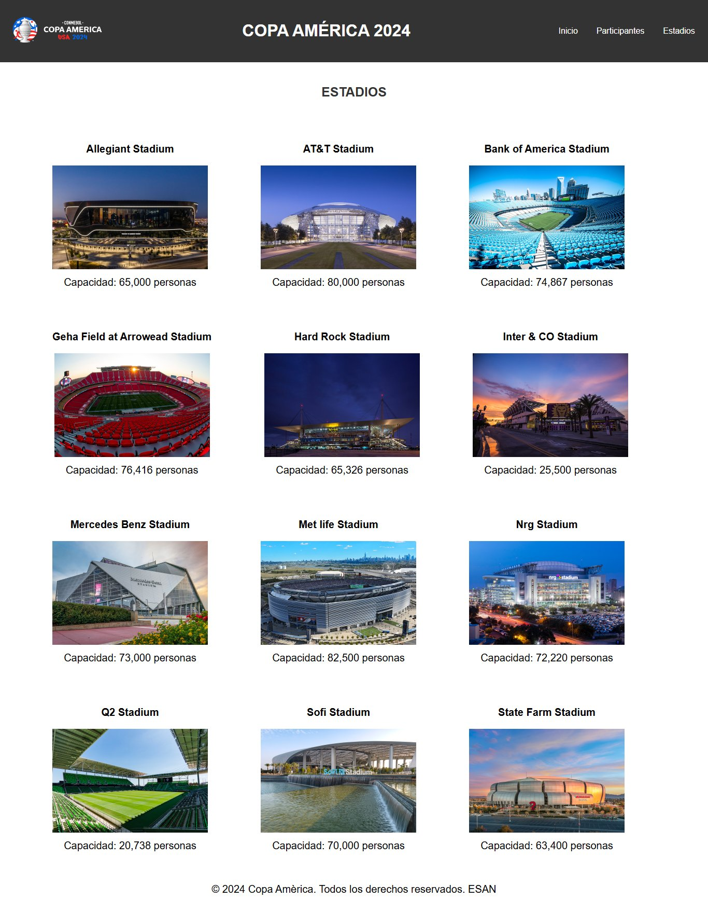

# Copa América 2024 — Sitio Web Informativo

Sitio web estático sobre la **Copa América 2024**, la 48.ª edición del torneo de selecciones más antiguo del mundo, disputado en Estados Unidos del 20 de junio al 14 de julio de 2024.

El sitio reúne en un solo lugar la presentación del torneo, una cuenta regresiva hacia el partido inaugural, un carrusel de noticias, videos oficiales, las selecciones participantes y los estadios sede. Está construido solo con **HTML5, CSS3 y JavaScript**, sin frameworks ni dependencias externas.

---

## Tabla de contenidos

- [Vista general](#vista-general)
- [Capturas del sistema](#capturas-del-sistema)
- [Funcionalidades](#funcionalidades)
- [Tecnologías utilizadas](#tecnologías-utilizadas)
- [Estructura del proyecto](#estructura-del-proyecto)
- [Instalación y ejecución](#instalación-y-ejecución)
- [Funcionamiento de los scripts](#funcionamiento-de-los-scripts)
- [Publicación en GitHub Pages](#publicación-en-github-pages)
- [Hoja de ruta](#hoja-de-ruta)
- [Cómo contribuir](#cómo-contribuir)
- [Licencia](#licencia)
- [Autor](#autor)

---

## Vista general

| Página | Archivo | Contenido |
|---|---|---|
| Inicio | `index.html` | Banner principal, cuenta regresiva, presentación del torneo, noticias y videos |
| Participantes | `participantes.html` | Selecciones con bandera, capitán y enlace a sus partidos |
| Estadios | `estadios.html` | Estadios sede con fotografía, capacidad y enlace a más información |

La navegación es la misma en todas las páginas gracias a un encabezado fijo en la parte superior, con el logo del torneo y el menú principal.

---

## Capturas del sistema

### Inicio

Encabezado fijo con el menú, banner principal, cuenta regresiva hacia el inicio del torneo y texto de presentación.



### Noticias

Dos carruseles que rotan automáticamente cada 3 segundos. Cada imagen enlaza a la nota en el medio original.



### Videos

Videos oficiales del torneo incrustados desde YouTube.



### Participantes

Cuadrícula de selecciones con su bandera y capitán. Al pulsar una bandera se abre la búsqueda de los partidos de esa selección.



### Estadios

Cuadrícula de estadios sede con fotografía y capacidad.



---

## Funcionalidades

- **Encabezado fijo** con logo y menú, siempre visible al desplazarse.
- **Cuenta regresiva** en tiempo real (días, horas, minutos y segundos) hasta el partido inaugural. Cuando la fecha pasa, muestra un mensaje de finalización.
- **Carrusel de noticias** automático, con imágenes de medios peruanos e internacionales que enlazan a la nota original.
- **Videos incrustados** de YouTube con soporte para pantalla completa.
- **Fichas de selecciones** con bandera, nombre y capitán.
- **Fichas de estadios** con fotografía, nombre y capacidad.
- **Efecto hover** en tarjetas y menú para indicar los elementos interactivos.
- **Enlaces externos** que se abren en una pestaña nueva para que el sitio siga abierto.

---

## Tecnologías utilizadas

| Tecnología | Uso |
|---|---|
| HTML5 | Estructura semántica de las páginas (`header`, `nav`, `section`, `footer`) |
| CSS3 | Maquetación con Flexbox, encabezado fijo, efectos hover y sombras |
| JavaScript (ES5) | Cuenta regresiva y rotación de imágenes del carrusel |
| YouTube Embed | Reproducción de videos incrustados |

No hace falta compilar, empaquetar ni instalar dependencias.

---

## Estructura del proyecto

```text
RepoCopaAmerica/
├── index.html                  Página principal
├── participantes.html          Selecciones participantes
├── estadios.html               Estadios sede
├── styles.css                  Estilos de la página principal
├── styles_participantes.css    Estilos de la página de participantes
├── styles_estadios.css         Estilos de la página de estadios
├── temporizador.js             Lógica de la cuenta regresiva
├── noticias.js                 Lógica del carrusel de noticias
├── images/                     Logo, favicon, banner y banderas
├── images_estadios/            Fotografías de los estadios
├── images_noticias/            Imágenes de las noticias
├── docs/
│   └── capturas/               Capturas usadas en este README
├── LICENSE                     Licencia MIT
└── README.md
```

---

## Instalación y ejecución

### 1. Clonar el repositorio

```bash
git clone https://github.com/AcuLuis/RepoCopaAmerica.git
cd RepoCopaAmerica
```

### 2. Levantar un servidor local (recomendado)

Puedes abrir `index.html` con doble clic, pero **YouTube bloquea los videos incrustados en páginas abiertas con `file://`** y muestra el *Error 153*. Para ver el sitio completo, sírvelo por HTTP con cualquiera de estas opciones:

**Con Python**

```bash
python -m http.server 8000
```

**Con Node.js**

```bash
npx serve .
```

**Con Visual Studio Code**

Instala la extensión *Live Server*, haz clic derecho sobre `index.html` y elige **Open with Live Server**.

### 3. Abrir en el navegador

```
http://localhost:8000
```

---

## Funcionamiento de los scripts

### `temporizador.js` — Cuenta regresiva

1. Define la fecha objetivo del inicio del torneo.
2. Cada segundo (`setInterval`) calcula la diferencia en milisegundos entre la fecha objetivo y la actual.
3. Convierte esa diferencia en días, horas, minutos y segundos.
4. Escribe el resultado en el elemento `#contador`.
5. Cuando la diferencia es negativa, detiene el intervalo y muestra un mensaje de finalización.

### `noticias.js` — Carrusel de noticias

1. Guarda dos listas de rutas de imágenes, una por carrusel.
2. Lleva un índice por carrusel que avanza cada 3 segundos y vuelve a `0` al llegar al final.
3. Cambia el atributo `src` de `#imagen1` y `#imagen2` con la imagen correspondiente.

---

## Publicación en GitHub Pages

1. En el repositorio, ve a **Settings → Pages**.
2. En **Source**, elige **Deploy from a branch**.
3. Selecciona la rama `main` y la carpeta `/ (root)`.
4. Guarda los cambios. El sitio quedará disponible en:

```
https://aculuis.github.io/RepoCopaAmerica/
```

---

## Hoja de ruta

Mejoras previstas, organizadas por fases:

| Fase | Enfoque | Puntos principales |
|---|---|---|
| 1 | Correcciones | Carrusel cargado dos veces, enlaces de noticias que no coinciden con la imagen, datos incompletos de selecciones y estadios, HTML inválido |
| 2 | Experiencia de usuario | Diseño responsive, menú uniforme en todas las páginas, tarjetas con CSS Grid, carrusel con controles, una sola hoja de estilos base |
| 3 | Lógica funcional | Datos en JSON renderizados con JavaScript, grupos y tablas de posiciones, calendario y resultados, contador con estados (antes, durante y después del torneo) |
| 4 | Calidad y despliegue | Accesibilidad, optimización de imágenes, SEO, publicación automática en GitHub Pages con validación |

---

## Cómo contribuir

1. Haz un *fork* del repositorio.
2. Crea una rama para tu cambio: `git checkout -b mejora/nombre-del-cambio`.
3. Haz tus cambios y confírmalos: `git commit -m "Describe el cambio"`.
4. Sube la rama: `git push origin mejora/nombre-del-cambio`.
5. Abre un *Pull Request* explicando qué cambiaste y por qué.

---

## Licencia

El código fuente de este proyecto se distribuye bajo la **Licencia MIT**. Consulta el archivo [LICENSE](LICENSE) para más detalles.

**Contenido de terceros:** los nombres, logotipos y marcas de la Copa América, CONMEBOL, Concacaf, las federaciones nacionales y los estadios, así como las imágenes de noticias y los videos incrustados, pertenecen a sus respectivos titulares. Se usan solo con fines educativos e informativos y no están cubiertos por la licencia MIT.

---

## Autor

**Luis Antonio Acuña Ayala**
GitHub: [@AcuLuis](https://github.com/AcuLuis)

Proyecto académico — ESAN.

---

<div align="center">

## ⭐ ¿Te gustó este proyecto? ⭐

Si este proyecto te resultó útil, te inspiró o simplemente te gustó,
**regálale una estrella en GitHub**. Es gratis, se hace en un segundo
y ayuda muchísimo a que más personas lo descubran. 🙌

[](https://github.com/AcuLuis/RepoCopaAmerica/stargazers)

**¡Gracias por tu apoyo!** 🏆⚽

</div>
